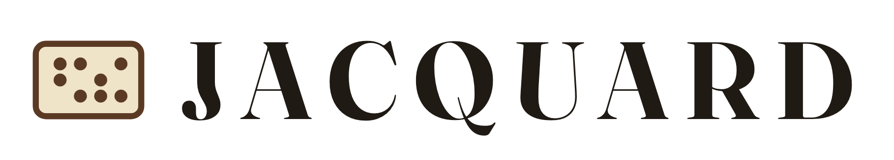
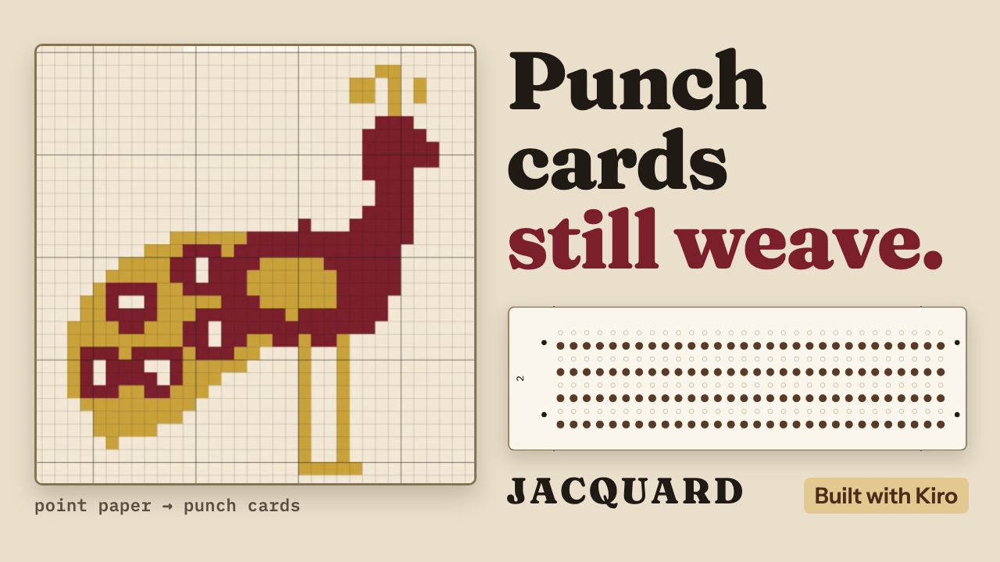
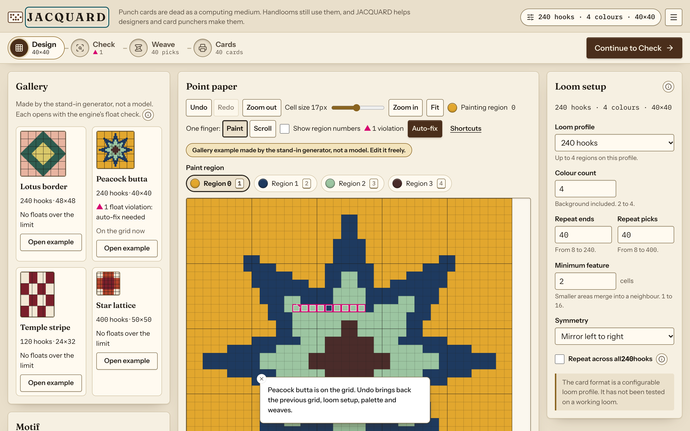
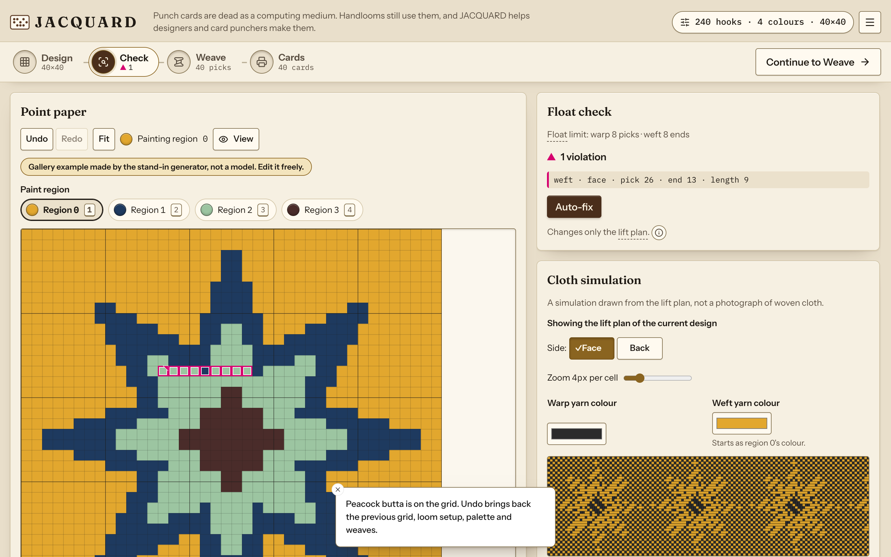
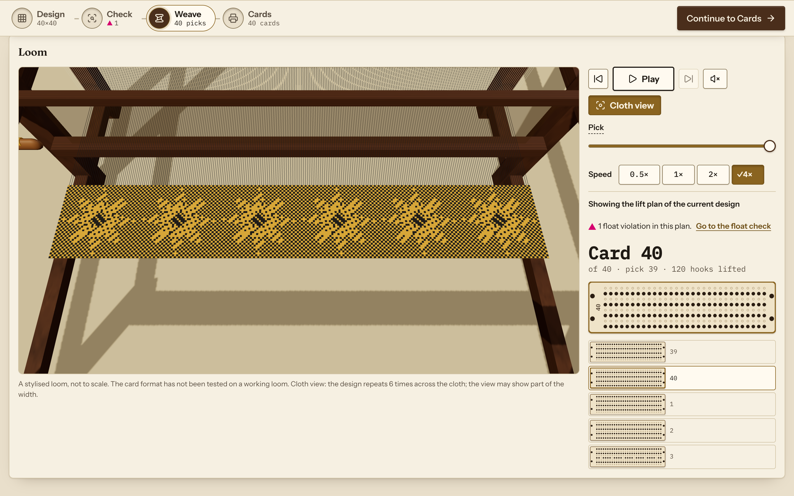
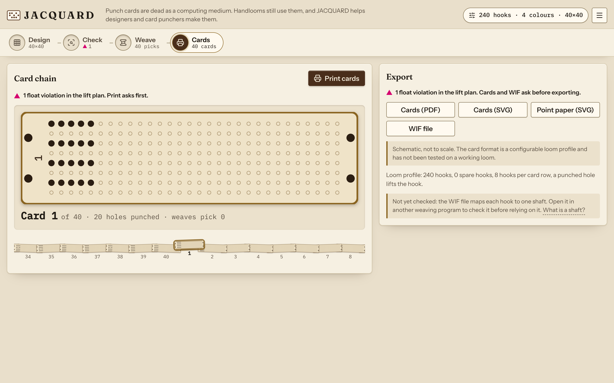
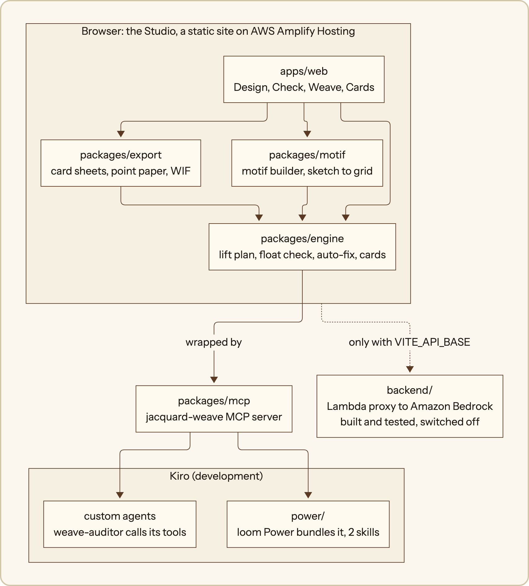
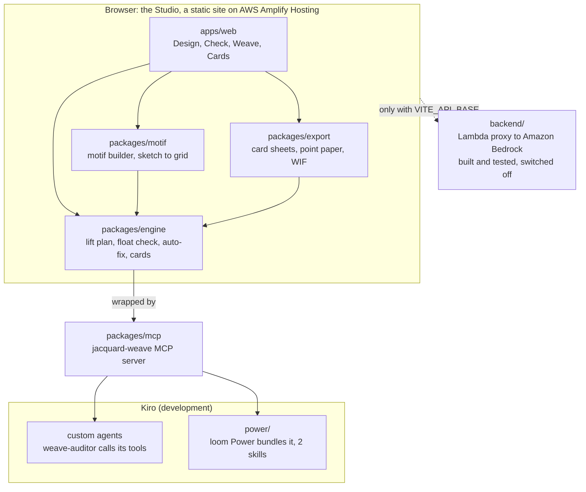
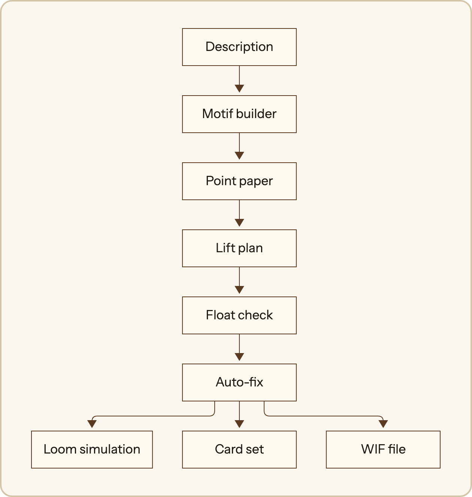
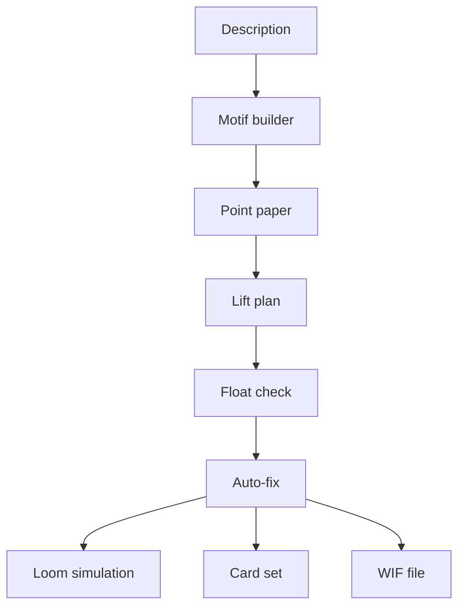

<p align="center">
  <picture>
    <source media="(prefers-color-scheme: dark)" srcset="media/brand/jacquard-logo-dark.png">
    
  </picture>
</p>

<p align="center"><b>Punch cards are dead as a computing medium. Handlooms still weave from them. JACQUARD helps designers and card punchers design, check, weave and print them.</b></p>

| Link | Where |
|---|---|
| Live app | https://main.d28e9v65r7sow0.amplifyapp.com |
| Demo video (2 min 49 s) | https://youtu.be/kInqm4saNN0 |
| Kiro journal | [`KIRO_JOURNEY.md`](KIRO_JOURNEY.md) |
| Specs | [`.kiro/specs/`](.kiro/specs) |
| Steering, hooks and agents | [`.kiro/`](.kiro) |
| The `loom` Power | [`power/`](power) |
| The weave MCP server | [`packages/mcp/`](packages/mcp) |
| Licence | [MIT](LICENSE) |

[](https://youtu.be/kInqm4saNN0)

## The problem

In 1804 Joseph-Marie Jacquard's loom read its pattern from a chain of punched cards, one card for each pass of the weft (a *pick*). Each hole decides whether one hook lifts, and each hook lifts one warp thread (an *end*). Computers borrowed the idea and later dropped it. Handlooms did not: Banarasi sarees are still woven on hand looms with a jacquard, and a 2023 handwoven Banarasi piece for India's Parliament building was put onto the loom with Jacquard punch cards ([S2, S3](#sources)).

A card set starts as a drawing on point paper (squared paper where each square is one end crossing one pick). The designer has to watch for *floats*: places where a thread passes over many threads in a row without interlacing. Long floats snag and weaken the cloth. On paper they are easy to miss, and a float missed there ends up punched into the cards.

JACQUARD is for:

- handloom designers who draw motifs and plan weaves;
- card punchers who turn a design into a physical card set;
- weaving students and hobbyists who want to see how a design becomes cards.

India's Fourth All India Handloom Census (2019-20) counts about 35.22 lakh handloom weavers and allied workers ([S5](#sources)). That figure covers all handlooms, not only jacquard looms; we have no source for how many of them use punch cards.

The tool assists the designer and the card puncher. It does not replace them. The card format is a configurable loom profile and **has not been tested on a working loom**.

## What it does, in four steps

| Step | What happens | |
|---|---|---|
| **1. Design** | Describe a motif ("a lotus with four petals on a plain ground") or open a gallery example. The motif builder draws clean, limited-colour shapes on point paper, and you touch them up cell by cell. Loom setup: hook count, region limit, repeat size. |  |
| **2. Check** | The engine gives each region a binding weave, builds the lift plan and lists every float over the limit, highlighted on the grid. Auto-fix flips the fewest lift-plan cells it can, and never changes the drawing. |  |
| **3. Weave** | A stylised 3D Jacquard loom lifts exactly the hooks each card lifts, and the cloth grows pick by pick. Play, pause, scrub, four speeds, optional sound, and a Cloth view of the finished motif. |  |
| **4. Cards** | The card set, numbered in lacing order, to print (PDF or SVG), plus a point-paper sheet and a WIF file for other weaving software. Cards and WIF wait until the float check is clean, or you choose to export anyway. |  |

## Try it in two minutes

On https://main.d28e9v65r7sow0.amplifyapp.com (no sign-in):

1. A short opening plays once (under 4 seconds). Click **Skip**, or press Escape, to go straight to the Studio.
2. In **Design**, find the **Gallery** and click **Open example** on **Peacock butta** (240 hooks, 40 by 40). The motif appears on the point paper.
3. Click **Continue to Check**. The float check lists one violation: a weft float of 9 at pick 26, end 13, over the limit of 8. It is highlighted on the grid.
4. Click **Auto-fix**. It flips one lift-plan cell and the check shows no floats over the limit.
5. Click **Continue to Weave**. Switch **Sound** on and click **Play**. The loom lifts each card's hooks and the cloth grows. When the last pick is woven, the camera moves to the **Cloth view** and shows the repeated peacocks.
6. Click **Continue to Cards**. Scroll the laced card chain, then click **Print cards** to open the print dialog with the card sheet.
7. In **Export**, click **WIF file** to download `jacquard-240.wif`. **Cards (PDF)**, **Cards (SVG)** and **Point paper (SVG)** sit beside it.

To try your own motif, go back to **Design** and type into **Describe the motif**, for example "a peacock" or "an eight-point star", then click **Generate motif**. The chips under the box show what the builder understood.

## For judges

The five equally weighted Kiroween criteria, and where to find the evidence for each.

| Criterion | Evidence |
|---|---|
| **Potential impact** | A real audience: designers and card punchers on handlooms that still weave from punch cards ([S2, S3](#sources)). The app is free, needs no account and runs in the browser. Lighthouse on the live site: mobile 99 / 100 / 100, desktop 100 / 100 / 100 for performance, accessibility and best practices ([`media/motif-builder/lighthouse.txt`](media/motif-builder/lighthouse.txt)). Its outputs (printable cards, a point-paper sheet, a WIF file) are what a card puncher and other weaving software take in. Not yet tested on a working loom ([limits](#honest-limits)). |
| **Technological implementation** | [How Kiro built it](#how-kiro-built-it): 9 specs, 99 property-based tests, 7 steering files, 3 hooks, 5 custom agents, our own MCP server plus 2 external ones in use, a Power, a headless Kiro CLI check, and an autopilot run through six phases. Every session is in [`KIRO_JOURNEY.md`](KIRO_JOURNEY.md), failures included. |
| **Design** | A four-step Studio with one primary action per step, a 3D loom with sound, and checked empty, loading, error and phone states ([screenshots](media/polish)). The `design-reviewer` agent reviewed the UI 10 times against [`design-language.md`](.kiro/steering/design-language.md). |
| **Innovation / idea** | The first programmable medium, brought back for the people who still use it. Loom facts come from a public-domain 1909 textbook on Jacquard machines ([S1](#sources)), and each one is labelled `[sourced]`, `[convention]`, `[decision]` or `[to verify]` in the code and in every MCP tool result. A float check with auto-fix on a lattice, a card set that decodes back to the same lift plan, and WIF export in one browser tool. |
| **Presentation** | A [2 min 49 s demo](https://youtu.be/kInqm4saNN0) of the live site from description to WIF file, with captions, plus this README and the journal. |

## How Kiro built it

The whole project was built in Kiro IDE, with one Kiro CLI run. Each row is a Kiro surface we used, with one moment from the journal.

| Surface | What we used it for | One concrete moment | What it gave us |
|---|---|---|---|
| **Specs** (9) | Requirements first, then design and tasks, for every feature: [`weave-engine`](.kiro/specs/weave-engine), [`weave-mcp`](.kiro/specs/weave-mcp), [`motif-input`](.kiro/specs/motif-input), [`simulate-and-export`](.kiro/specs/simulate-and-export), [`kiro-product`](.kiro/specs/kiro-product), [`studio-experience`](.kiro/specs/studio-experience), [`deploy-static`](.kiro/specs/deploy-static), [`motif-builder`](.kiro/specs/motif-builder), [`demo-video`](.kiro/specs/demo-video). Each has a Decision log. | Requirement 2.7 of motif-builder (every builder motif passes the float check after auto-fix) became Property 3 and task 1.5 ([`tasks.md`](.kiro/specs/motif-builder/tasks.md)). | Every acceptance criterion traces to a test. When a test proved the spec wrong, the spec was fixed and the change logged, not the test weakened. |
| **Property-based tests** (99, fast-check) | The invariants: card set to lift plan round trip, no float over the limit after auto-fix, every end bound, one card per pick, same input gives the same bytes. | A one-character bug planted on purpose in `checkFloats` shrank to a plan with 2 picks and 1 end ([journal](KIRO_JOURNEY.md#2026-11-16--planted-bug-check-off-by-one-in-checkfloats)). | 3 real bugs caught (a mirrored paisley border with no figures, a loose cloth-view camera, a voice trimmer judging a line silent) and an error in a design document. |
| **Steering** (7) | 5 always-on files ([`product.md`](.kiro/steering/product.md), [`tech.md`](.kiro/steering/tech.md), [`structure.md`](.kiro/steering/structure.md), [`journey.md`](.kiro/steering/journey.md), [`autopilot.md`](.kiro/steering/autopilot.md)) and 2 file-matched ones: [`weaving-domain.md`](.kiro/steering/weaving-domain.md) for `packages/engine/**`, [`design-language.md`](.kiro/steering/design-language.md) for `apps/web/**`. | The shell tool reported `Exit Code: -1` for every command, so `tech.md` now makes the agent print `EXIT_CODE=$?` and read the test summary line before it may say tests pass ([journal](KIRO_JOURNEY.md#2026-11-16--spec-format-conversion-started-shell-exit-code-rule)). | The domain file keeps loom facts labelled and sourced. The framing rules (no unsourced numbers, "assists, never replaces") hold across every session. |
| **Hooks** (3) | [`block-engine-fixture-edits`](.kiro/hooks/block-engine-fixture-edits.json) (Pre Tool Use guard on golden fixtures), [`engine-typecheck-and-test-on-save`](.kiro/hooks/engine-typecheck-and-test-on-save.json), [`journey-entry-on-stop`](.kiro/hooks/journey-entry-on-stop.json). | The save hook caught the planted `checkFloats` bug one second after the edit: `save-hook result: typecheck=0 test=1` ([journal](KIRO_JOURNEY.md#2026-11-16--planted-bug-check-off-by-one-in-checkfloats)). | The guard checked 286 file-tool calls during the autopilot run and blocked none, so the fixtures stayed untouched. The Stop hook is why the journal has an entry for every session. |
| **Custom agents** (5) | [`weave-auditor`](.kiro/agents/weave-auditor.json) and [`design-reviewer`](.kiro/agents/design-reviewer.json) (read-only phase reviews), [`spec-checker`](.kiro/agents/spec-checker.json) (headless spec check), [`release-runner`](.kiro/agents/release-runner.json) and [`journey-scribe`](.kiro/agents/journey-scribe.json). | At the end of Phase B, `weave-auditor` called all six jacquard-weave tools live and checked 33 label entries against the engine's profiles ([journal](KIRO_JOURNEY.md#2026-11-16--phase-b-end-weave-auditor-review-of-weave-mcp)). | `weave-auditor` ran 8 times and found 12 unlabelled loom facts; `design-reviewer` ran 10 times and its findings were fixed or answered in each spec's Decision log. `release-runner` has not run yet. |
| **MCP: our own server** | [`packages/mcp`](packages/mcp): six tools over the engine (`list_profiles`, `build_lift_plan`, `check_floats`, `auto_fix`, `build_cards`, `decode_cards`), registered in [`.kiro/settings/mcp.json`](.kiro/settings/mcp.json). It adds no weaving logic of its own. | Same Phase B audit: the auditor checked designs through the real engine instead of reading code ([journal](KIRO_JOURNEY.md#2026-11-16--phase-b-end-weave-auditor-review-of-weave-mcp)). | Kiro's agents can check floats and card round trips on any design or example file. 0 float or round-trip errors were found in any review. |
| **MCP: external servers** | Chrome DevTools MCP (phone-width checks, screenshots, `lighthouse_audit`) and AWS Documentation MCP (Amplify Hosting steps and custom headers). Context7 is registered but was not used. | Before the deploy, the AWS Documentation server answered how a manual Amplify deployment works and what it costs ([journal](KIRO_JOURNEY.md#2026-11-24--deploy-static-waves-1-and-2-tasks-21-to-32-the-static-site-on-aws-amplify-hosting)). | The live site was checked end to end at 1440x900 and 390x844 with no console errors, and deployed from documented steps. |
| **Power** | [`power/`](power): the `loom` Power with `plugin.json`, the MCP server bundled into one file, and 2 skills (`design-woven-pattern`, `check-floats-and-cards`). | [`packages/mcp/test/power.test.ts`](packages/mcp/test/power.test.ts) starts the bundled server from a folder outside the repo and fails if the committed bundle differs from a fresh build. | Anyone can add the weave tools to Kiro without this repo's build. It has not yet been installed in a fresh workspace by hand. |
| **Kiro CLI, headless** | `kiro-cli chat --v3 --no-interactive --agent spec-checker` checks changed files against the specs. [`.github/workflows/kiro-spec-check.yml`](.github/workflows/kiro-spec-check.yml) runs the same command in CI. | One local run over 25 changed files ended `VERDICT: PASS` ([output](media/journey/2026-11-16-kiro-cli-spec-check-local.txt), [journal](KIRO_JOURNEY.md#2026-11-16--kiro-product-wave-1-tasks-31-32-33-release-check-workflow-ci-spec-check-kiro-web-prompt)). | A spec check that needs no IDE. The CI job is off: Kiro API keys need a paid plan, so it has not run on GitHub. |
| **Autopilot** | [`autopilot.md`](.kiro/steering/autopilot.md): standing orders to run Phases B to H wave by wave without waiting, with fixed stop conditions (AWS spend, making the repo public, a contradiction with the plan, three failures). | One run on 2026-11-16 built the MCP server, motif input, simulator and exports, the Kiro product pieces and the polish, committing each wave and tagging each phase (`phase-B`, `C`, `D`, `F`, `G`, `H`) ([journal](KIRO_JOURNEY.md#2026-11-16--autopilot-standing-orders-weave-mcp-wave-0-task-11)). | Long unattended runs that still stopped to ask before anything cost money. |

### Where Kiro surprised us

- **Hooks were silent until the workspace was trusted.** Our first live hook tests showed nothing. Kiro's log line `hooks.v2.executionDisabledUntrustedWorkspace` gave the cause, and trusting the folder fixed it ([journal](KIRO_JOURNEY.md#2026-11-16--hook-test-fixture-write-blocked-source-edit-allowed)).
- **A test proved the design document's arithmetic wrong.** The auto-fix lattice example (task 11.4) failed. Instead of loosening the assertion, the sub-agent stopped and showed that no fix keeping every flip on the lattice exists for a 24-pick warp ring: eight ends have only two lattice picks. The design note was corrected, not the code ([journal](KIRO_JOURNEY.md#2026-11-16--weave-engine-checkpoint-mid-waves-13-and-14-tasks-114-1113-121-122-125)).
- **A planted bug shrank to a two-pick counterexample.** Changing `<=` to `<` in `checkFloats` failed Properties 18 and 23 within 4 tests, each shrunk to one end and two picks, lifted then not lifted ([journal](KIRO_JOURNEY.md#2026-11-16--planted-bug-check-off-by-one-in-checkfloats)).
- **The mirrored paisley border was caught on its first run.** motif-builder Property 2 (seed 6102) found that a paisley border mirrored top to bottom had no figures at all. The fix went into the builder and requirement 2.5 ([journal](KIRO_JOURNEY.md#2026-11-24--motif-builder-spec-and-wave-0-tasks-11-to-16)).
- **What Kiro missed: the woven cloth did not show the design.** Four waves of screenshots used the loom view and the first card, and none showed that about 200 of 240 hooks wove plain ground. The builder found it by using the app. Wave 5 of studio-experience turned repeat across on and added the Cloth view ([journal](KIRO_JOURNEY.md#2026-11-24--studio-experience-wave-5-tasks-61-to-68-the-woven-result-shows-the-design)).

### Numbers

Counted in the repo on 2026-11-24.

| Item | Count |
|---|---|
| Specs | 9 |
| Property-based tests | 99 (engine 34, weave-mcp 16, motif-input 14, simulate-and-export 11, studio-experience 10, demo-video 9, motif-builder 4, deploy-static 1) |
| Tests in total | 727 (engine 148, mcp 110, export 52, motif 101, backend 45, web 231, video 40) |
| Steering files | 7 |
| Hooks | 3 |
| Custom agents | 5 |
| MCP servers | 4 registered: jacquard-weave (ours), Chrome DevTools, AWS Documentation, Context7 (not used) |
| Phase tags | 11 (`git tag`): `phase-B`, `C`, `D`, `F`, `G`, `H`, `polish`, `polish-2`, `deploy`, `motif`, `video` |

## Architecture

<picture>
  <source media="(prefers-color-scheme: dark)" srcset="media/brand/architecture-dark.png">
  
</picture>

<details><summary>Mermaid source</summary>



</details>

Everything the live site does runs in the browser: there is no server call. The engine is pure TypeScript with no runtime dependencies, and the same input always gives the same bytes.

From a description to the outputs:

<picture>
  <source media="(prefers-color-scheme: dark)" srcset="media/brand/data-flow-dark.png">
  
</picture>

<details><summary>Mermaid source</summary>



</details>

## Run it locally

Works on macOS, Linux and Windows. You need Node.js 22 or later (tested with 22.23.3) and Git.

```sh
git clone https://github.com/TusharTechs/jacquard.git
cd jacquard
corepack enable            # gives you pnpm 12.16.1 from package.json
pnpm install
pnpm --filter @jacquard/web dev     # the Studio at http://127.0.0.1:5173
```

Vite uses the next free port if 5173 is taken, and prints the address. If `corepack enable` is not allowed on your machine, install pnpm with `npm install -g pnpm@12.16.1` instead.

Checks and build:

```sh
pnpm test                               # every package, once (no watch mode)
pnpm typecheck
pnpm --filter @jacquard/web build       # static site in apps/web/dist
```

All `pnpm` commands work the same in PowerShell, cmd, bash and zsh. The scripts in `scripts/*.sh` (deploy and the account-ID check) need bash: on Windows use Git Bash or WSL. Deploying needs your own AWS account and is not needed to run the app.

### Add the weave MCP server to Kiro

```sh
pnpm --filter @jacquard/mcp build       # writes packages/mcp/dist/index.js
```

Open the repository folder in Kiro. [`.kiro/settings/mcp.json`](.kiro/settings/mcp.json) already registers the server as `jacquard-weave`, and it appears in the MCP panel with six tools. To use it from another workspace, add this to that workspace's `.kiro/settings/mcp.json`, with the absolute path to your clone:

```json
{
  "mcpServers": {
    "jacquard-weave": {
      "command": "node",
      "args": ["<path-to-clone>/packages/mcp/dist/index.js"]
    }
  }
}
```

### Install the loom Power

The Power needs no build: `power/dist/server.js` is committed.

- **Kiro IDE:** Powers panel → **Add Custom Power** → **Import power from a folder**, then pick the `power/` folder of your clone.
- **Kiro CLI:** `kiro-cli powers install <path-to-clone>/power`

[`power/README.md`](power/README.md) has a test prompt and what to expect.

## Repository map

| Path | What it holds |
|---|---|
| [`packages/engine`](packages/engine) | The weave engine: weaves per region, lift plan, float check, auto-fix, card set and decode. Pure TypeScript, no runtime dependencies. |
| [`packages/motif`](packages/motif) | Motif SVG validation, rasterising to a design grid, speck removal, symmetry, the motif builder and the stand-in generator. |
| [`packages/export`](packages/export) | Cloth model, WIF writer and reader, card sheets (SVG, PDF), point-paper sheet. |
| [`packages/mcp`](packages/mcp) | The jacquard-weave MCP server. |
| [`apps/web`](apps/web) | The Studio (React, three.js for the loom). |
| [`backend`](backend) | The Lambda proxy to Amazon Bedrock. Built and tested, not deployed. |
| [`power`](power) | The `loom` Kiro Power. |
| [`video`](video) | The demo video, made with Remotion from real app output and a capture of the live site. |
| [`.kiro`](.kiro) | Specs, steering, hooks, agents, the release-check workflow and the MCP settings. |
| [`scripts`](scripts) | Deploy to Amplify Hosting, the gallery generator and the account-ID check. |
| [`media`](media) | Screenshots and clips referenced by the journal, and the brand images. |
| [`KIRO_JOURNEY.md`](KIRO_JOURNEY.md) | One entry per session or spec wave, with failures and property-test counterexamples. |

## Honest limits

- **The card format has not been tested on a working loom.** Card layouts are configurable loom profiles. Only the 400-hook card layout is sourced (S1); other layouts are marked `[to verify]`. The 3D loom is stylised.
- **The AI path is off.** The live site uses a motif builder with a fixed grammar, not a model, and says so on screen. The Bedrock proxy in `backend/` is built and tested but needs Bedrock model access, which this deployment does not have. An uploaded sketch is not traced on the live site.
- **The motifs are stand-ins.** The gallery examples and builder motifs are made by deterministic code, not by a designer.
- The WIF file has not yet been opened in another weaving program, so its mapping is marked `[to verify]`.

## Sources

- **S1** *Jacquard Machines: Instruction Paper*, Lowell Textile School, American School of Correspondence, 1909. [Project Gutenberg ebook #50532](https://www.gutenberg.org/ebooks/50532). Hooks, needles and card layout.
- **S2** District Varanasi, Government of Uttar Pradesh, [Banaras Brocades and Sarees](https://varanasi.nic.in/district-produce/banarasi-saree/) (GI product page): the sarees are woven on the conventional Banaras hand loom jacquard.
- **S3** The Times of India, 20 June 2023, [a handwoven Banarasi installation in India's new Parliament building](https://timesofindia.indiatimes.com/life-style/fashion/buzz/32-feet-long-handwoven-installation-by-tilfi-banaras-on-display-at-indias-new-parliament-building/articleshow/101104214.cms), translated onto the loom with Jacquard punch cards.
- **S4** Encyclopaedia Britannica, [Buta](https://www.britannica.com/art/buta): an ornamental floral motif of Mughal Indian art, used in textiles.
- **S5** Ministry of Textiles, [Fourth All India Handloom Census 2019-20](https://handlooms.nic.in/assets/img/Statistics/3736.pdf), and the Development Commissioner (Handlooms), [Brief on the handloom sector](https://handlooms.gov.in/assets/img/Statistics/Background_note_on_handloom_sector.pdf): 35.22 lakh handloom weavers and allied workers.

That handlooms still weave from punched cards is stated in S2 and S3. We have not checked it on a working loom.

## Credits

- Demo video narration: a synthetic voice, Kokoro-82M (hexgrad, Apache-2.0 licence), run locally (`video/voice/tts/`). The words are the builder's own script.
- Fonts: Fraunces, Instrument Sans and IBM Plex Mono, through Fontsource.

## Licence

MIT, see [`LICENSE`](LICENSE).
